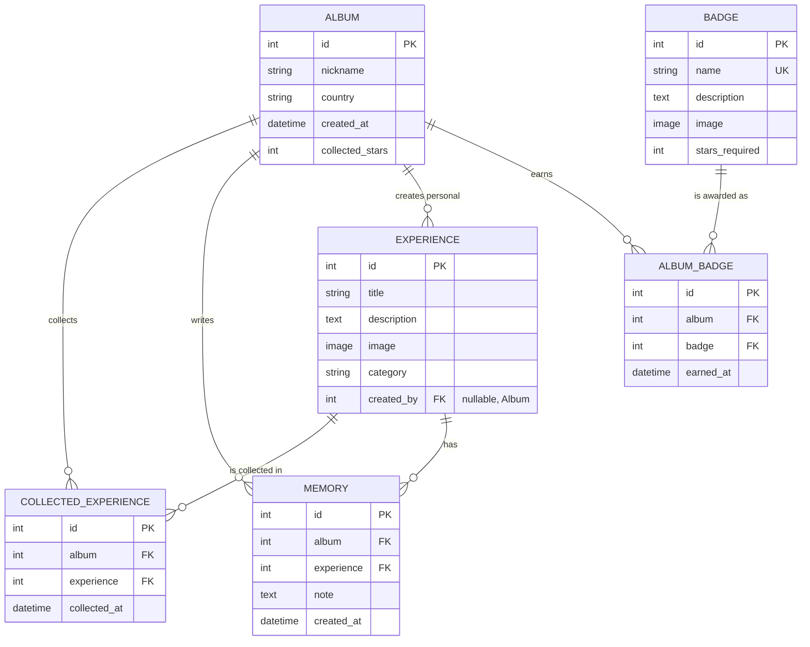

# BEF Album – Burgas Eurovision Fan Album

A Django web application for a Eurovision fan visiting **The Eurovision Song Contest 2027 in Burgas**.

The fan creates a personal album, gathers experiences around Burgas and the contest, collects stars for each one and earns badges for completing experience categories or reaching star milestones. For every collected experience the fan can write, edit and delete a personal memory.

> Authentication is intentionally not implemented. The fan works with a single album at a time, which can be created, edited and deleted.

## Features

- **Album** – create, view, edit and delete your fan album (nickname + country).
- **Experiences** – browse predefined experiences by category, filter them and collect them to earn stars.
- **Personal experiences** – create up to 5 of your own experiences ("My Own Adventure").
- **Stars** – each category gives a different number of stars:

  | Category | Name | Stars |
  |----------|------|-------|
  | Sights | Burgas Treasures | 2 |
  | Eurovision | Eurovision Fever | 5 |
  | Nearby | Beyond Burgas | 3 |
  | Culinary | Taste Bulgaria | 1 |
  | Personal | My Own Adventure | 4 |

- **Badges** – awarded automatically (they cannot be created or edited by the user):
  - category badges for collecting all 5 experiences in a category,
  - *Eurovision Explorer* for all 20 predefined experiences,
  - *Ultimate Explorer* for all 20 predefined plus 5 personal experiences,
  - *Star Collector I / II / III* for 15 / 30 / 50 stars.
- **Memories** – write, view, edit and delete a memory for every collected experience.
- Custom 404 page, base template with reusable partials, Bootstrap-style custom design, form validation with custom messages.

## Screenshots

- [Album](docs/screenshots/album.png)
- [Experiences](docs/screenshots/experiences.png)
- [Personal experiences](docs/screenshots/personal_experiences.png)

## Project Structure

| App | Responsibility |
|-----|----------------|
| `albums` | Album and Memory models, home page, album and memory CRUD views |
| `experiences` | Experience model, listing/filtering, collecting, personal experiences, custom template filters |
| `badges` | Badge and AlbumBadge models, automatic badge-awarding service |

```
BEFAlbum/
├── albums/              # albums app
├── experiences/         # experiences app (+ templatetags)
├── badges/              # badges app (+ services.py)
├── djangoprojectalbum/  # project settings and root urls
├── templates/           # base.html, 404.html, page templates and partials
├── static/              # CSS and images
├── docs/screenshots/    # README screenshots
├── .env.example         # example environment variables
└── requirements.txt
```

### Database Diagram (ERD)



Album ↔ Experience is a many-to-many relation through `CollectedExperience`. Album ↔ Badge works the same way through `AlbumBadge`.

### Database Models

- `Album` – nickname, country, collected stars; unique (nickname, country).
- `Experience` – title, description, image, category; optional FK to the album that created it (personal experiences).
- `CollectedExperience` – through model for the **many-to-many** relation Album ↔ Experience.
- `Memory` – **many-to-one** to Album and to Experience.
- `Badge` – name, description, image, stars required.
- `AlbumBadge` – **many-to-one** to Album and Badge; unique per album and badge.

## Setup

Requirements: Python 3.12+ (required by Django 6.x) and `pip`.

```bash
git clone https://github.com/marina-morska/BEFAlbum.git
cd BEFAlbum

python -m venv .venv
source .venv/bin/activate      # Windows: .venv\Scripts\activate

pip install -r requirements.txt

cp .env.example .env           # Windows: copy .env.example .env

python manage.py migrate
python manage.py runserver
```

Open <http://127.0.0.1:8000/>.

### Environment Variables

Defined in the `.env` file in the project root (a ready-to-use template is `.env.example`):

| Variable | Example | Description |
|----------|---------|-------------|
| `SECRET_KEY` | `your-secret-key-here` | Django secret key. Use any random string locally. |
| `DEBUG` | `True` | Must be exactly `True` to enable debug mode. |
| `ALLOWED_HOSTS` | `127.0.0.1,localhost` | Comma-separated list of allowed hosts. |

The default database is SQLite (`db.sqlite3`, created by `migrate`), so no database credentials are needed. The optional PostgreSQL settings (`DB_NAME`, `DB_USER`, `DB_PASS`, `DB_HOST`, `DB_PORT`) are commented out in `.env.example` and `settings.py`.

No admin panel, fixtures or prepopulated data are needed – everything is created through the application's UI.

## Technologies

Python, Django, SQLite, Pillow, python-dotenv, HTML, CSS.
